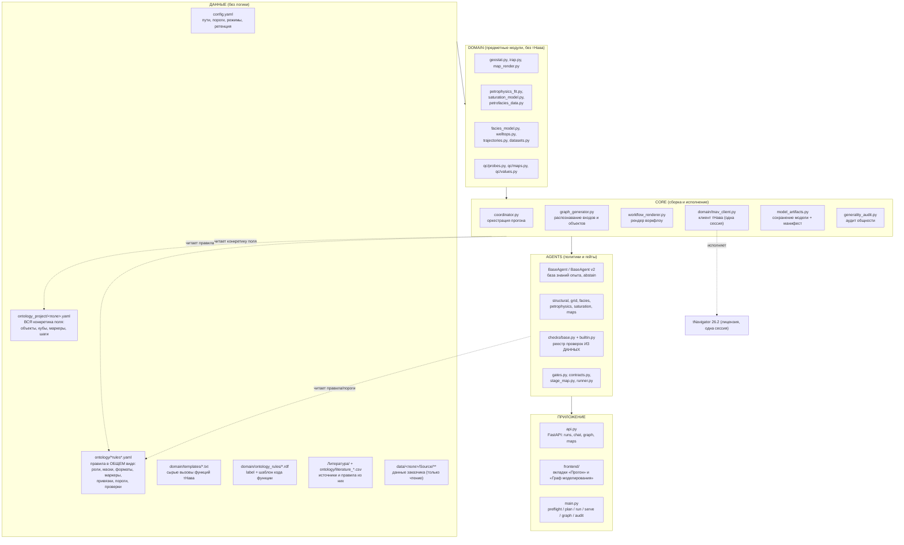
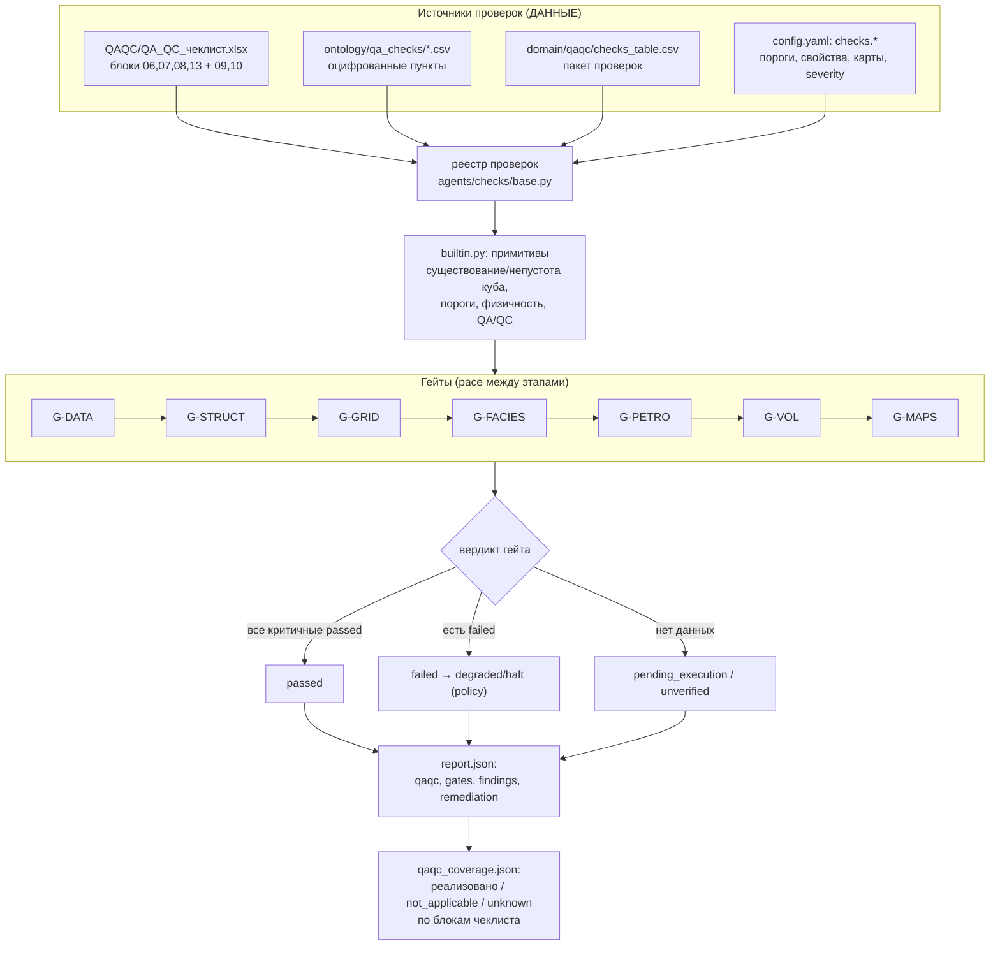
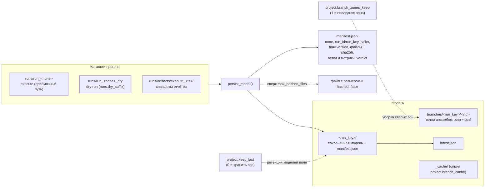
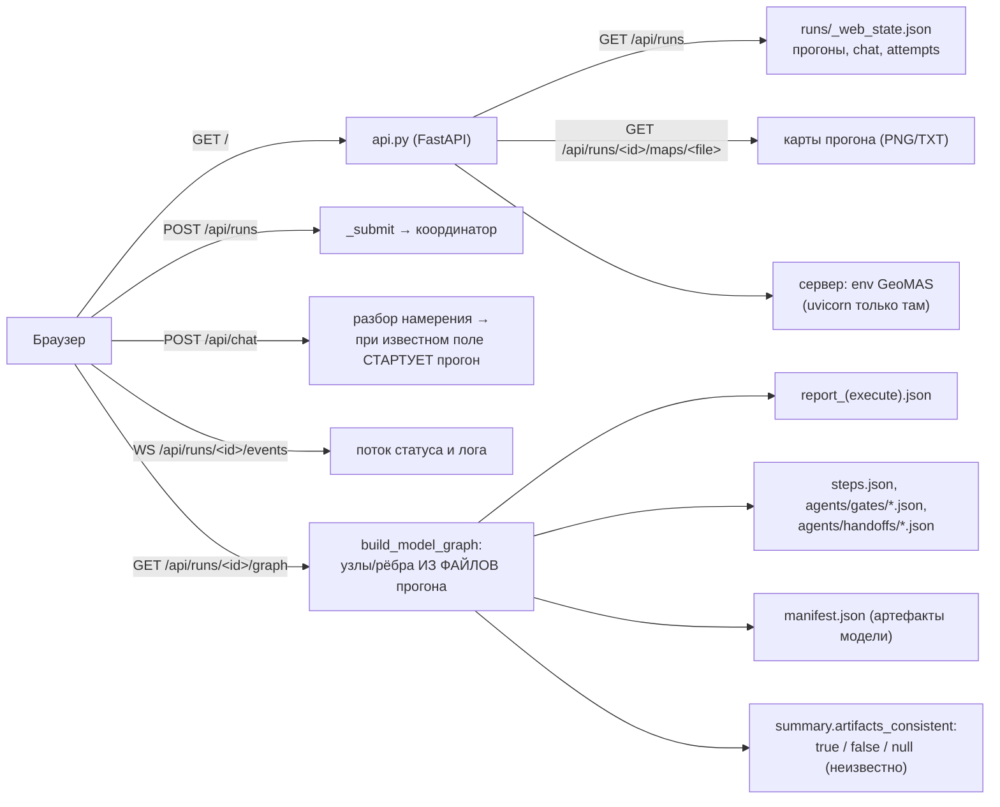
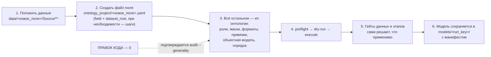

# 18. Архитектурные схемы `orchestrator_v8`

Документ содержит **схемы архитектуры прототипа** (Mermaid). Диаграммы рендерятся на GitHub/в VS Code
и в любом просмотрщике Markdown с поддержкой Mermaid. Текстовое описание слоёв — в
[01_ARCHITECTURE.md](01_ARCHITECTURE.md), правила разработки — в [AGENT_RULES.md](AGENT_RULES.md).

> Все схемы отражают фактическое состояние кода. Где поведение зависит от данных (`config.yaml`,
> `ontology/*.yaml`, `ontology_project/<поле>.yaml`), это отмечено на схеме.

---

## 1. Слои системы



---

## 2. Сборка воркфлоу из онтологии (без хардкода)

```mermaid
flowchart LR
    A["Данные поля<br/>data/&lt;поле&gt;/Source"] --> B["graph_generator:<br/>распознавание по СОДЕРЖИМОМУ<br/>и маскам из ontology"]
    O1["ontology/input_recognition_rules.yaml<br/>роли, маски, форматы, internal_key"] --> B
    B --> C["inputs: роли + форматы<br/>(well_tops, deviation, logs, ...)"]
    O2["ontology/object_binding_rules.yaml<br/>bindings, bindings_by_function,<br/>producers/consumers, naming"] --> D
    C --> D["object model:<br/>имена объектов выводятся из данных,<br/>а не из кода"]
    P["ontology_project/&lt;поле&gt;.yaml<br/>pipeline: этапы → шаги"] --> E
    D --> E["derive + reconcile:<br/>состав, приоритеты, порядок"]
    O3["ontology/*_rules.yaml<br/>composition: выгрузки после<br/>производителей"] --> E
    E --> F["draft.graph: этапы → шаги<br/>с параметрами и объектами"]
    F --> G{"у поля есть<br/>проектный pipeline?"}
    G -- "да (Герасимовское)" --> H["_pipeline_genes:<br/>порядок поля"]
    G -- "нет (новое поле)" --> I["_ontology_genes:<br/>состав из онтологии"]
    H --> J["workflow_renderer:<br/>шаблон + .rdf + подстановки"]
    I --> J
    J --> K["постадийные артефакты<br/>runs/&lt;прогон&gt;/agents/stages/*.py"]
    K --> L["tNavigator: исполнение этапов"]
    F -. "контроль" .-> M["object_flow:<br/>потребитель раньше производителя?"]
    M -. "нарушение" .-> E
```



**Проверка общности одной командой:** `python main.py audit --generality` — печатает
нарушения правила 1 в коде, параметры объектов в правилах онтологии и **доказательство**:
состав и роли для поля, которого нет в `ontology_project` (или с минимальным файлом данных).
Ожидаемый вердикт — `passed` при `0/0/0`.

---

## 3. Полный прогон: последовательность

```mermaid
sequenceDiagram
    autonumber
    participant U as Пользователь / CLI / Web
    participant C as coordinator
    participant A as агенты (политики)
    participant G as гейты + проверки
    participant T as tNavigator
    participant M as model_artifacts

    U->>C: run --field <поле> [--execute]
    C->>C: блокировка runs/.run.lock (F-25)
    C->>C: _stage_data: копия данных в каталог прогона
    Note over C: execute → runs/run_<поле><br/>dry-run → runs/run_<поле>_dry (данные)
    C->>C: подготовка маркеров и траекторий<br/>(формато-осознанные адаптеры)
    C->>A: сборка состава и решений (данные + БЗ)
    A-->>C: план этапов, объекты, параметры
    C->>C: рендер воркфлоу (шаблон + .rdf)
    loop по этапам
        C->>T: исполнение этапа
        T-->>C: статус, объекты, свойства
        C->>G: свидетельства → проверки
        G-->>C: passed / failed / unverified / not_applicable
        Note over G: нет данных → unverified,<br/>никогда не «passed» (правило 6)
    end
    opt ансамбль
        loop по вариациям S001..S00N
            C->>T: прогон ветки
            T-->>C: метрика ветки
            Note over C: ветки в models/branches/&lt;run_key&gt;/&lt;vid&gt;<br/>rmtree только внутри своей зоны
        end
        C->>C: выбор лучшей ветки (из данных)
    end
    C->>M: persist_model: копия модели + manifest.json (sha256)
    M-->>C: verdict=saved / workflow_only + предупреждения
    C->>C: отчёт report.json (+ снапшот в runs/artifacts)
    C->>C: снятие блокировки
    C-->>U: статус, вердикт QA/QC, карты, путь модели
```

---

## 4. QA/QC в форме гейтов



Ключевые инварианты: гейт **не может** стать `passed`, если результата нет (F-19); проверки
существования и непустоты куба работают по свидетельствам проб (`property_stats`,
`grid_properties`), а доля непустых сравнивается с порогом **из данных**
(`checks.properties.<роль>.min_fraction`, F-27).

---

## 5. Ансамбль, изоляция и сохранение модели



---

## 6. Веб-слой и вкладка «Граф моделирования»



Вкладка показывает: последовательность этапов и шагов, решения агентов со свидетельствами,
ветвления ансамбля с метриками и лучшей ветвью, вызванные проверки Метакритика с
вердиктом/severity/remediation. Цвет (`tone`) считает **сервер по данным** — во фронтенде нет
ни одного зашитого названия этапа, гейта или ветви.

---

## 7. Расширение: добавление нового месторождения



Практическая проверка на втором объекте (иной формат данных): гейт `G-DATA` проходит без
провалов (маркеры 79/224, траектории 67/0), структурные и сеточные этапы — `passed`;
все адаптеры формато-осознанные, исходные данные заказчика не изменяются.

---

## 8. Что проверяется автоматически (и где смотреть результат)

| Проверка | Команда | Ожидаемый результат |
|---|---|---|
| Полная батарея тестов | `Get-ChildItem tests -Filter "test_*.py"` (или `pytest -q`) | 24 файла, `exit=0` |
| Общность онтологии и отсутствие домена в коде | `python main.py audit --generality` | `passed` (0 нарушений, 0 параметров объектов, 0 долга) |
| Предполётная проверка окружения и данных | `python main.py preflight` | `preflight: OK` |
| Dry-run поля | `python main.py run --field <поле>` | `error 0`, `render_warnings []`, каталог `runs/run_<поле>_dry` |
| Приёмка (одна сессия тНава, под блокировкой) | `python main.py run --field Герасимовское --execute` | 5/5 ветвей, `best=S002`, сетка 250×311×22, 9 карт, `model_artifacts.verdict=saved` |
| Граф моделирования | `GET /api/runs/<id>/graph?source=execute` | 200, узлы/рёбра с атрибутами, честные 404/409/400 |

**Правило эксплуатации:** приёмочные `--execute` запускаются **по одному**, под
`runs/.run.lock` и с каталогом прогона внутри репозитория — параллельный прогон даёт
вырожденный результат (`scored=0`), это проверено экспериментально.

---

## 9. Отрендеренные схемы и встраивание в документы

Mermaid-разметка выше — **источник**. Для отчётов схемы отрисованы в PNG офлайн-скриптом
(в окружении нет mermaid-cli, поэтому рендер детерминированный, на matplotlib):

```powershell
& $py -X utf8 tools/render_architecture.py --out docs/architecture_png
```

| Файл | Что содержит |
|---|---|
| `docs/architecture_png/01_sloi_sistemy.png` | слои системы |
| `docs/architecture_png/02_sborka_iz_ontologii.png` | сборка воркфлоу из онтологии |
| `docs/architecture_png/03_posledovatelnost_progona.png` | полный прогон |
| `docs/architecture_png/04_qaqc_geity.png` | QA/QC-гейты |
| `docs/architecture_png/05_ansambl_i_model.png` | ансамбль, изоляция, сохранение модели |
| `docs/architecture_png/06_veb_i_graf.png` | веб-слой и граф моделирования |
| `docs/architecture_png/07_novoe_mestorozhdenie.png` | добавление нового месторождения |

**Встроено в итоговые документы** (скрипт только дополняет, существующее не трогает):

* `docs/ОТЧЁТ_ГеоМАС_v8_обновление_10.10.docx` — приложение «Архитектурные схемы»: 7 схем с подписями;
* `docs/ГеоМАС_v8_ИТОГ_приёмка.pptx` — раздел «Приложение. Архитектурные схемы»: заголовочный слайд + 7 слайдов.

Повторное встраивание после перерисовки (нужен интерпретатор с `python-docx` и `python-pptx` —
bundled-рантайм DSH; в системной Anaconda есть только `python-pptx`):

```powershell
& $dshpy -X utf8 tools/embed_architecture.py
```
